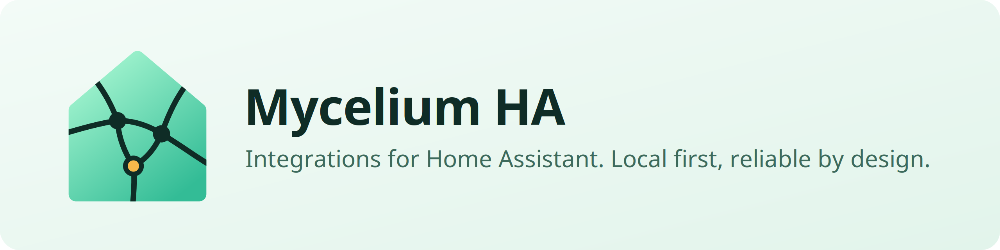

<picture>
  <source media="(prefers-color-scheme: dark)" srcset="https://raw.githubusercontent.com/mycelium-ha/.github/main/branding/banner-dark.png">
  
</picture>

Like a mycelium beneath the forest floor, our integrations connect the devices in your home quietly and reliably, so you can forget they are there.

## Why Mycelium HA

**Local first.** Your devices keep working without the internet wherever the hardware allows it. When a product only offers a cloud service, we use its official API, never a scraped or reverse-engineered one.

**Reliable by design.** Every integration is tested against real Home Assistant and checked against the next Home Assistant beta every week, so updates don't break your setup.

**Feels native.** Setup happens entirely in the Home Assistant UI. Entities are translated, devices are grouped properly, and diagnostics are safe to share because personal identifiers are removed.

## Integrations

| Integration | Devices | Connection | Status |
| --- | --- | --- | --- |
| [**free@home Local**](https://github.com/mycelium-ha/freeathome-local) | ABB-free@home and Busch-free@home (Busch-Jaeger), System Access Point 2.0 | Local, official API | Stable |
| [**Mobile Alerts Cloud**](https://github.com/mycelium-ha/mobilealerts-cloud) | Technoline Mobile Alerts and TFA Dostmann WeatherHub sensors | Cloud, official API | Stable |

More integrations are on the way.

## Installation

1. In Home Assistant, open **Settings → Marketplace**.
2. Search for the integration, or choose **Add from link** and paste the repository URL from the table above.
3. Install it, then set it up under **Settings → Devices & services**.

Each integration's README covers configuration, supported devices and troubleshooting.

## Help and contributing

- **Found a bug or have an idea?** Open an issue in the integration's repository.
- **Questions?** See [support](https://github.com/mycelium-ha/.github/blob/main/SUPPORT.md).
- **Security issue?** Report it privately, as described in the [security policy](https://github.com/mycelium-ha/.github/blob/main/SECURITY.md).
- **Want to help?** Code, translations and device testing are all welcome; see [contributing](https://github.com/mycelium-ha/.github/blob/main/CONTRIBUTING.md).
- **Building an integration?** Start from the [integration template](https://github.com/mycelium-ha/integration-template).

Mycelium HA is an independent community project and is not affiliated with Home Assistant, the Open Home Foundation or Nabu Casa.
